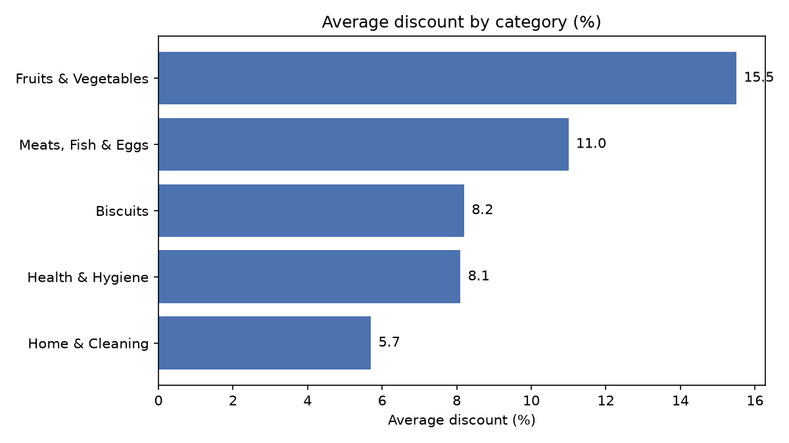
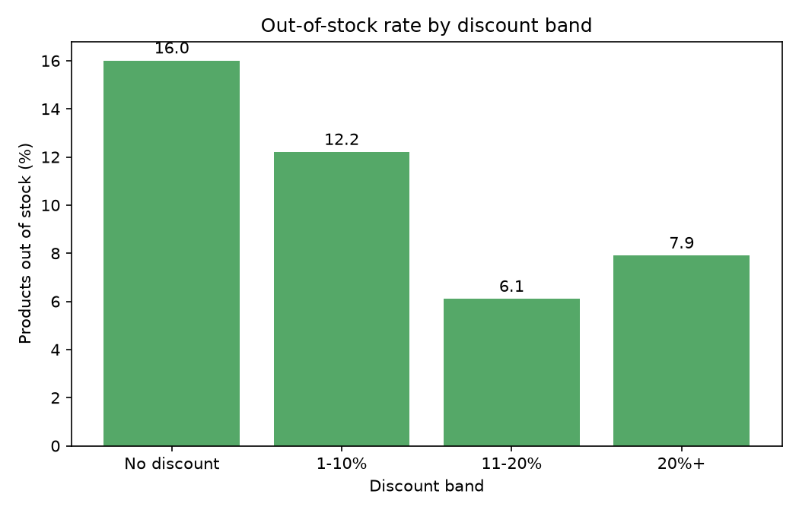

# Zepto Inventory & Pricing Analysis

An end-to-end data analysis project on Zepto product listings, using SQL (PostgreSQL), Python (pandas) and an interactive dashboard.

## Business questions
- Which categories offer the deepest discounts?
- Which categories have the most out-of-stock products?
- Where is the most inventory value concentrated?
- Which products give the best value per 100 g?
- Does discount depth relate to stock-outs?

## Dataset
- Source: Zepto product listing data (zepto_v1.xlsx, Sheet1)
- 3,730 rows and 9 columns: category, product name, MRP, discount %, available quantity, selling price, weight (g), out-of-stock flag, pack quantity

## Data cleaning (clean_zepto.py)
- Prices were stored in paise, so I converted MRP and selling price to rupees
- Removed 1 product with a price of 0
- Treated a weight of 0 as missing, not a real weight
- The same product was listed under several categories, so I kept one row per product (3,729 rows reduced to 1,800 unique products) and saved every product-category pair in a separate mapping table
- Added discount_band, stock_status, price_per_100g and inventory_value columns

## Data limitation
Several categories contain exactly the same products (for example Cooking Essentials and Munchies), so those categories cannot be compared reliably. Category-level conclusions focus on categories with distinct product lists.

## Stock status of the 1,800 unique products
- In stock: 1,328
- Low stock (1-2 units): 255
- Out of stock: 217

## Project structure
- data/ : raw and cleaned CSV files
- sql/ : schema and analysis queries
- notebooks/ : Python EDA
- dashboard/ : interactive dashboard
- images/ : charts used in this README
- clean_zepto.py : data cleaning script

## Tools
PostgreSQL, Python (pandas, matplotlib), an HTML dashboard, Git and GitHub

## Key insights

1. **Fruits & Vegetables has the deepest discounts** (15.5 percent on average) and a low out-of-stock rate (6.5 percent).
2. **Biscuits has the highest out-of-stock rate** (28.6 percent) even though its average discount is only 8.2 percent, so this looks like a stock availability issue, not a pricing one.
3. **Heavy discounting does not appear to drive stock-outs.** Products with no discount were out of stock most often (16.0 percent), while products discounted 11-20 percent were out of stock least often (6.1 percent). This is a single snapshot, so it shows an association, not a cause.
4. **Some deeply discounted products have no stock.** Several items discounted 40-50 percent show zero available units.

## Recommendations

1. **Review stock levels for Biscuits.** It has the highest out-of-stock rate (28.6 percent), and discounts do not explain it, so replenishment is the first thing to check.
2. **Check deeply discounted products with zero stock.** Promotions running on unavailable items (for example 50 percent off yogurt and pasta) can disappoint customers and waste promotional effort.
3. **Test discounts before expanding them.** Products discounted 11-20 percent had the lowest stock-out rate, so a controlled test of discount depth would show whether discounts help or only coincide with healthy stock.
4. **Fix the product data.** Products are listed under several categories and weights mix grams, millilitres and piece counts. Cleaning this at the source would make category and price-per-unit analysis reliable.

## Limitations
- This is a single snapshot of listings, with no sales or time data, so results show associations and not causes.
- Inventory value is an estimate (price times available quantity), and available quantity only reaches 6 in this data.
- Several categories contain identical product lists, so category comparisons focus on the five distinct ones.
